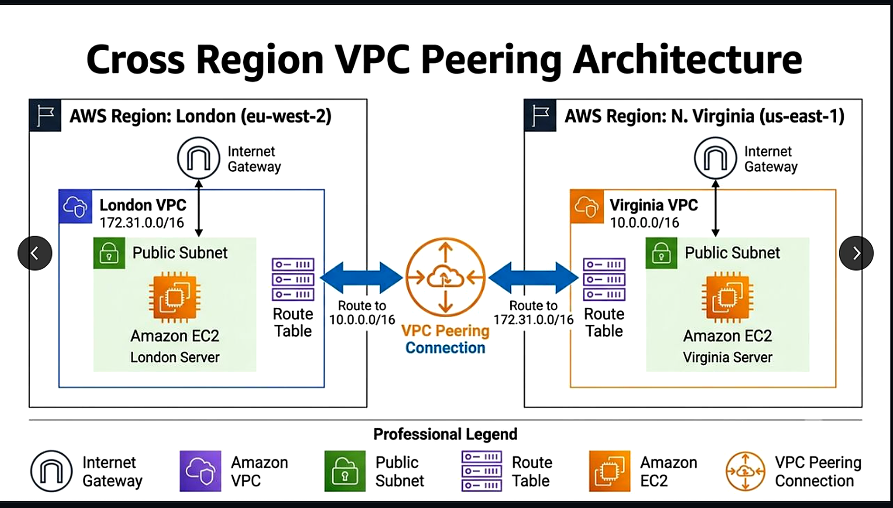

# Engineering Deep Dive — AWS Cross-Region VPC Peering

**From networking fundamentals to evidence-driven troubleshooting, using a real London ↔ N. Virginia AWS lab.**

> **Learning goal:** Understand not only *how to connect two VPCs*, but **why the connection works, what breaks it, how to diagnose it, and what the screenshots do (and do not) prove.**
>
> **Evidence policy:** This guide distinguishes (1) observed project results, (2) design logic supported by AWS documentation, and (3) illustrative experiments to try later. It is **not** a claim of years of production experience, a complete security audit, or a Terraform deployment.

**Start here:** [Project overview](README.md) · [Architecture image](diagrams/cross-region-vpc-peering-architecture.png) · [Evidence index](docs/EVIDENCE-INDEX.md) · [Validation runbook](docs/VALIDATION.md)

---

## Contents

1. [The problem — a story in two cities](#1-the-problem--a-story-in-two-cities)
2. [Networking concepts, explained without jargon](#2-networking-concepts-explained-without-jargon)
3. [Our actual lab topology](#3-our-actual-lab-topology)
4. [The packet's journey: London to Virginia and back](#4-the-packets-journey-london-to-virginia-and-back)
5. [Peering lifecycle: control plane versus data plane](#5-peering-lifecycle-control-plane-versus-data-plane)
6. [Route tables: the part that makes or breaks it](#6-route-tables-the-part-that-makes-or-breaks-it)
7. [Security groups, NACLs and host firewalls](#7-security-groups-nacls-and-host-firewalls)
8. [CIDRs, overlap and IP-address planning](#8-cidrs-overlap-and-ip-address-planning)
9. [How to verify the lab like an engineer](#9-how-to-verify-the-lab-like-an-engineer)
10. [Troubleshooting playbook](#10-troubleshooting-playbook)
11. [Common design misunderstandings](#11-common-design-misunderstandings)
12. [Security, encryption and DNS](#12-security-encryption-and-dns)
13. [Peering versus Transit Gateway and VPN](#13-peering-versus-transit-gateway-and-vpn)
14. [Performance, availability and cost](#14-performance-availability-and-cost)
15. [Safe AWS CLI inspection examples](#15-safe-aws-cli-inspection-examples)
16. [Exercises: move from tutorial to engineering](#16-exercises-move-from-tutorial-to-engineering)
17. [Evidence ledger — what actually happened](#17-evidence-ledger--what-actually-happened)
18. [Interview questions with thoughtful answers](#18-interview-questions-with-thoughtful-answers)
19. [Glossary](#19-glossary)
20. [Further reading and source verification](#20-further-reading-and-source-verification)

---

## 1. The problem — a story in two cities

Imagine an order-processing application in **London** and a reporting service in **N. Virginia**. Both are hosted on AWS EC2, but **inside different VPCs** in different AWS Regions.

The London application knows the Virginia instance's **private IP address**. It tries to send a packet to it. That address is not a public internet endpoint. AWS must have a deliberate network route to that other VPC, and the destination must allow the traffic.

**The failure of a naive assumption:** *“Both servers are on AWS, so their private IPs should automatically reach each other.”* They do not. VPCs are separate logical networks unless you establish an appropriate connectivity mechanism.

**The architectural answer for this two-VPC lab:** an **inter-Region VPC peering connection**, with non-overlapping IP ranges, correct route-table entries, and permitted traffic.

**The engineering answer:** do not stop when the console shows `Active`. Log in to an instance and **prove that an end-to-end packet reaches the peer and receives a response**. Then describe the scope of what that test proves.

A useful mental model:

- **VPC:** a private neighborhood with its own street addresses.
- **Subnet:** a block of addresses within that neighborhood.
- **Route table:** the directions that say which road to take for another neighborhood.
- **Peering connection:** the AWS-managed road between two neighborhoods.
- **Security group / NACL / OS firewall:** gates that may still reject the visitor.
- **`ping`:** sending a simple knock and seeing whether an answer comes back.

An open road with a locked gate will not give you connectivity. A green connection status without a return route is not enough either.

## 2. Networking concepts, explained without jargon

### VPC and Region are different concepts

An **AWS Region** is a geographical grouping of AWS infrastructure (for example `eu-west-2`). A **VPC** is a logically isolated virtual network created in a Region. A Region may contain many VPCs. A VPC does not stretch across Regions.

An **Availability Zone (AZ)** is a distinct location *inside* a Region. Inter-Region peering connects VPCs in different Regions, not merely in different AZs.

### IP addresses: public and private

- **Private IP:** used inside VPC address spaces and for traffic across correctly connected VPCs. Here we test `172.31.23.144` and `10.0.137.157`.
- **Public IP:** potentially reachable through internet-oriented routes if the applicable network and firewall rules allow. The screenshots contain public IPs used for remote administration; that **does not** mean the tested inter-VPC packets used the public internet.
- **CIDR:** a compact way to describe a range of addresses. `10.0.0.0/16` covers `10.0.0.0` through `10.0.255.255`. `172.31.0.0/16` covers `172.31.0.0` through `172.31.255.255`.

### What is a route?

Every VPC route table contains routes defining how IP packets are forwarded. A route has a **destination**, such as `10.0.0.0/16`, and a **target**, such as `local`, an internet gateway, or a **peering connection**.

A destination route toward the peer VPC must exist in the route table **actually associated with the source instance's subnet**. Merely creating an additional route table that no subnet uses accomplishes nothing.

### What are ICMP and ping?

`ping` uses **ICMP Echo Request / Echo Reply** messages. An answer establishes **ICMP reachability at the moment of the test**. It does not prove SSH access, database connectivity, HTTP response, sustained throughput, or all application firewall settings.

## 3. Our actual lab topology



| Property | London side | Virginia side |
|---|---|---|
| AWS Region | `eu-west-2` | `us-east-1` |
| VPC range in architecture diagram | `172.31.0.0/16` | `10.0.0.0/16` |
| Observed EC2 private IP | `172.31.23.144` | `10.0.137.157` |
| Necessary route to peer | Destination `10.0.0.0/16` → `pcx-*` | Destination `172.31.0.0/16` → `pcx-*` |
| Evidence | [London EC2 screenshot](evidence/enhanced/02-london-ec2-instance.png) | [Virginia EC2 screenshot](evidence/enhanced/03-virginia-ec2-instance.png) |

**Read this diagram correctly:** it illustrates the intended architecture and route logic. The screenshots **show** the two running instances, the peering state, and ping replies. They do **not separately display both actual route-table contents** or all security-group rules. We therefore treat the route entries as **necessary design configuration, consistent with the test outcome**, not as separately archived screenshots of exact AWS console settings.

### Two independent endpoints, two directions

```
              AWS Region: London (eu-west-2)
                 VPC: 172.31.0.0/16
                 EC2: 172.31.23.144
                          |
         London subnet's effective route table
             10.0.0.0/16 -> pcx-...
                          |
                  VPC PEERING (AWS)
                          |
        Virginia subnet's effective route table
            172.31.0.0/16 -> pcx-...
                          |
             AWS Region: N. Virginia (us-east-1)
                    VPC: 10.0.0.0/16
                    EC2: 10.0.137.157
```

The return path is essential. A successful reply is not just evidence that a request reached its destination; it also means the reply was able to return at that point in time.

## 4. The packet's journey: London to Virginia and back

Let's mentally trace a single ICMP request:

1. A user runs `ping 10.0.137.157` **on the London EC2 instance**.
2. The Linux kernel sees that `10.0.137.157` is not on its own directly connected subnet. It sends the packet through its EC2 virtual network interface toward the VPC network.
3. AWS evaluates the route table associated with the London instance's subnet. A route matching `10.0.0.0/16` targets the VPC peering connection.
4. AWS carries the packet across its inter-Region network to the peered VPC. This peering traffic does **not** require the public IPs shown in the EC2 screenshots.
5. Destination-side network security and the instance's host firewall must permit the ICMP request. The Virginia host receives it.
6. The Virginia host sends an ICMP Echo Reply to `172.31.23.144`.
7. The return path must have the relevant route from Virginia to London; network rules must permit the reply. London receives the response.
8. `ping` prints a `time=... ms` value. That's an observed round-trip time (RTT) for that message—not a fixed property of the architecture.

Repeat in reverse to demonstrate **bidirectional** reachability.

**Distinction worth memorizing:** The Linux guest's `ip route` table and the AWS VPC subnet route table are *different layers*. Inspecting `ip route` **inside** EC2 does not reveal the full AWS VPC route table.

## 5. Peering lifecycle: control plane versus data plane

### Peering lifecycle, conceptually

1. **Requester:** one VPC owner initiates a connection request to another VPC.
2. **Accepter:** the other VPC owner accepts it.
3. **Active:** AWS reports the peering object as active.
4. **Routing and security:** the two VPCs still need suitable route tables and traffic permissions.
5. **Data-plane test:** application packets or ICMP flow end to end.

Our screenshot shows **`London-to-Virginia` as `Active`**: [view peering state](evidence/enhanced/04-vpc-peering-connection-active.png).

### Why status and connectivity can disagree

A peering object is a **control-plane resource**. It reflects the state of an AWS network relationship. It does not by itself assert that any chosen EC2 instance is allowed to reach any chosen port on the other side. A wrong route or security-group rule can still block traffic. AWS even documents that the peering connection can remain `Active` during a Region-related event that prevents traffic.

**Interview-quality phrasing:** “I validated both the control plane (active peering) and the data plane (private-IP ICMP replies). I would add application-layer and security tests before claiming production readiness.”

## 6. Route tables: the part that makes or breaks it

### A minimal conceptual routing model

**London subnet route table**

| Destination | Target | Meaning |
|---|---|---|
| `172.31.0.0/16` | `local` | Stay inside London's VPC |
| `10.0.0.0/16` | `pcx-EXAMPLE` | Reach Virginia via peering |

**Virginia subnet route table**

| Destination | Target | Meaning |
|---|---|---|
| `10.0.0.0/16` | `local` | Stay inside Virginia's VPC |
| `172.31.0.0/16` | `pcx-EXAMPLE` | Reach London via peering |

`pcx-EXAMPLE` is a **placeholder**, not a recovered real AWS resource ID. Your actual peering ID can be found in the AWS console or by running a read-only AWS CLI query on an account you own.

### Route tables belong to subnets

When an EC2 instance sends a packet, the effective VPC route table is determined by its **subnet association**. A subnet can be explicitly associated with a custom route table, or implicitly use the VPC's main route table.

**A classic troubleshooting mistake:** Engineer A adds a peering route to `Custom-RT`, then tests an instance in a subnet still associated with `Main-RT`. The connection stays `Active`, but packets do not take the intended peering path.

### The return route is not optional

Configuring only London's route to Virginia can create a one-way path. Virginia needs a route to reach London's CIDR for replies to return. When debugging, draw the forward **and** reply directions separately.

### Destination specificity and blackhole routes

AWS route tables select routes according to their routing rules, including longest-prefix-match for overlapping destinations. A peering route may appear as `blackhole` if its target connection isn't usable. Do not treat a listed route as automatically operational. Verify the target peering ID, destination range, connection state and actual instance connectivity.

## 7. Security groups, NACLs and host firewalls

Three independent security layers can affect a packet after its route is correct.

| Layer | Where it applies | Stateful? | Question to ask |
|---|---|---|---|
| **Security group (SG)** | Attached to an EC2 network interface | **Yes** | Is this instance allowed to receive the requested traffic? |
| **Network ACL (NACL)** | Associated with a subnet | **No** | Do request and response packets both pass the subnet rules? |
| **Host firewall** | Inside the Linux/Windows OS | Depends on software/rules | Is the OS itself blocking ICMP or the target port? |

### An illustrative ICMP test policy

For a minimally scoped *lab* ping test:

- London's SG inbound: ICMP Echo Request from `10.0.0.0/16` (or narrower authorized source).
- Virginia's SG inbound: ICMP Echo Request from `172.31.0.0/16` (or narrower authorized source).
- SG outbound rules must permit the appropriate **initiated** ICMP traffic; a stateful SG normally permits return traffic for an established/allowed flow.
- NACLs, being **stateless**, must permit relevant request and reply traffic in the correct directions on both sides.
- The OS firewall must allow ICMP responses.

**This is a safe *pattern*, not a claim that the exact source CIDRs/rules were captured in the screenshots.** For a real service, permit only required protocols and ports, ideally from the smallest practicable source ranges.

### Important inter-Region constraint

For **inter-Region VPC peering**, you **cannot** reference the other Region's *security group ID* in a local SG rule. Use an appropriate peer **CIDR** or specific IP range instead. Same-Region peer SG references are a different capability.

### Why `ping` may fail when SSH works

ICMP can be blocked independently of TCP. A successful SSH session does not prove ICMP permission, and a successful ping does not prove TCP/22 or PostgreSQL/5432 access. Validate the **protocol and port the real application needs**.

## 8. CIDRs, overlap and IP-address planning

### `/16` explained

A `/16` IPv4 CIDR reserves 16 bits as network prefix and leaves 16 bits for address positions. This describes a range of **65,536 addresses** mathematically. How many are *usable by resources* depends on subnetting and AWS reservations; don't confuse VPC range size with the number of instances you can actually launch.

Our two example ranges:

- `172.31.0.0/16`
- `10.0.0.0/16`

These **do not overlap**.

### Why overlap matters

Suppose both VPCs were `10.0.0.0/16`. A packet to `10.0.10.20` would be ambiguous: is it local or remote? AWS disallows peering configurations with overlapping VPC IPv4 CIDRs to prevent this class of ambiguity.

### Good future design habits

1. Reserve network blocks *before* creating environments.
2. Maintain an IP-address inventory or IPAM plan for multi-Region growth.
3. Separate broad VPC ranges from smaller subnet ranges.
4. Record the **actual** effective routes and per-subnet associations.
5. Avoid assuming peering will solve address conflicts.

## 9. How to verify the lab like an engineer

A mature test plan has multiple checkpoints—not one successful screenshot.

| Checkpoint | What to test | What this project's evidence supports |
|---|---|---|
| EC2 readiness | Instances running and status checks | **Observed** in regional EC2 screenshots |
| Peering control plane | Connection state active | **Observed** in VPC console screenshot |
| Forward ICMP | Virginia → London's private IP | **Observed** terminal replies |
| Reverse ICMP | London → Virginia's private IP | **Observed** terminal replies |
| Actual routes | Both effective subnet route tables and targets | **Not separately archived** |
| SG/NACL details | Exact access rules | **Not separately archived** |
| Application connectivity | SSH/HTTP/database TCP test over peering | **Not shown** |
| Resilience, latency distribution, throughput | Sustained and fault-injection test | **Not shown** |

### Re-run checks — illustrative commands, not historical claims

Run on **Virginia**, if you own/control a similarly configured lab:

```bash
ping -c 4 172.31.23.144
```

Run on **London**:

```bash
ping -c 4 10.0.137.157
```

Inspect guest network information:

```bash
ip -br addr
ip route
ip route get 10.0.137.157    # Run on London
```

The private IPs are from the **historical project screenshots**. They may no longer belong to currently running resources, and `ping` should only be used on instances you administer or are authorized to test.

**Improvement exercise:** Test a deliberately authorized application port using `nc -vz HOST PORT`, `curl` or an equivalent client *after starting a listening service*. Do not assume ICMP success implies TCP success.

### How much does a `time=76 ms` screenshot tell us?

It shows approximate *round-trip time for those particular ICMP replies*. It is **not** an SLA, median across days, a throughput benchmark, or a claim of zero packet loss under load. Reliability requires longer observations, workload-specific tests and error budgets.

## 10. Troubleshooting playbook

**Start with the symptom. Change only one variable at a time. Preserve evidence before and after each fix.**

### Scenario A — Peering request fails immediately

**Possible causes:** overlapping address spaces, invalid VPC IDs/Regions, authorization or request parameters.

**Investigate:** VPC CIDRs, requester/accepter Region, peering state reason, IAM permissions. Don't infer the root cause from `Failed` alone.

### Scenario B — Peering is Active but ping times out

Work through this order:

1. **Source/destination identity:** Are you logged into the intended host? Is the IP a *private* address assigned to the intended destination?
2. **Effective routes:** From London's subnet to `10.0.0.0/16` via peering; from Virginia's subnet to `172.31.0.0/16` via the same connection.
3. **Security groups:** Inbound ICMP on the receiving interface and appropriate outbound restrictions on sender.
4. **NACLs:** Inbound and outbound rules in both subnets, allowing request and reply.
5. **OS firewall:** ICMP echo policy, host health, network interface.
6. **Region/account:** Confirm each query and configuration action targets the correct Region and VPC.
7. **Evidence:** Save route and rule screenshots plus timed terminal outputs. Re-test after each deliberate correction.

### Scenario C — Only one direction works

Check which direction **initiates** the traffic and whether inbound SG permissions are symmetrical. Stateful SG return handling is different from independently permitting new flows initiated by either side. Verify each direction independently before claiming bidirectional access.

### Scenario D — Ping works but application connection fails

This is common and useful. ICMP Echo and TCP application traffic have different permissions and behavior.

Verify the service is actually listening (`ss -lnt`), bound to a reachable address, not only `127.0.0.1`, and the destination security group and host firewall permit the required port. Capture the exact error: timeout, refused, TLS error, or DNS failure.

### Scenario E — Route created, but remains `blackhole`

Confirm the route's target peering connection and its current lifecycle state. A route pointing to an unusable peering connection will not forward traffic even if it appears in the table.

### Scenario F — DNS name unexpectedly resolves to a public IP

Peering by private IP does **not** by itself guarantee the preferred hostname resolution behavior. Check the peering connection's DNS resolution options and VPC DNS settings. Verify the actual resolved address (`getent hosts`, `dig`, or equivalent) from the *source* instance.

### Suggested evidence capture for every investigation

```text
symptom -> time -> region -> source/destination IP
        -> peering status -> effective route table
        -> SG/NACL/host firewall -> retest output
        -> root cause (only when demonstrated)
        -> fix -> post-fix verification -> known limits
```

The historical console screenshot contains **two failed peering entries as well as one active entry**. Their root causes are *not visible*, so this guide does not pretend to reconstruct those specific failures.

## 11. Common design misunderstandings

### “Peering is Active, so every port works.”

**False.** Network route and security policy still apply. An active peering relation is a necessary step, not an application acceptance test.

### “Using private IPs means my instances have no public exposure.”

**False.** Private peering data-plane traffic and internet administration paths are different questions. Our screenshots show public instance addresses; restrict SSH/remote administration with approved access methods and least privilege.

### “A subnet is private because its name says `private`.”

**False.** Subnet naming is a label. Effective routing, assigned public IPs, internet gateway paths and security policies matter.

### “Peering uses the internet gateway.”

**False for peer-to-peer traffic.** The peer CIDR's route targets the peering connection. Internet gateways and NAT devices solve different problems.

### “Peering A↔B and B↔C lets A reach C.”

**False.** AWS peering is **non-transitive**. Design a direct A↔C peering connection where appropriate or evaluate a routing hub such as Transit Gateway/Cloud WAN.

### “Ping success proves secure production readiness.”

**False.** It proves ICMP reachability in a limited time window. Access control review, application protocol tests, logging, failover, capacity, DNS and operational procedures are separate work.

## 12. Security, encryption and DNS

### Is inter-Region traffic on the public internet?

AWS states that inter-Region VPC peering traffic **stays on the AWS global backbone**, does not traverse the public internet, and is **encrypted before leaving AWS facilities**. This refers to the AWS network transport. It is still sensible to use **application-layer TLS** for sensitive application data and to implement identity/access controls.

### Security is not provided by peering alone

For a production review, ask:

- Does each subnet have the **minimum required routes**?
- Are SG rules narrow in source range and service ports?
- Are NACLs and host firewalls understood, tested and maintainable?
- Are public administrative endpoints eliminated or tightly restricted?
- Is the workload authenticated and encrypted at application level?
- Are VPC Flow Logs, relevant CloudTrail activity and network-change records available?
- Are AWS IAM permissions for peering and route modification limited appropriately?

These are **recommendations**, not evidence that the historic lab implemented all of them.

### DNS resolution over peering

A private-IP ping requires no DNS. But applications often connect by name. Peering has specific DNS resolution settings: if relevant, enable requester/accepter DNS resolution options **after the connection becomes active**, then validate what names resolve to from each VPC. Do not claim DNS was configured unless you have a successful name-resolution test.

### Special inter-Region SG rule

Unlike some same-Region peering scenarios, an inter-Region peer's security-group ID cannot be referenced directly in an SG rule. Use appropriately scoped IP/CIDR destinations or sources.

## 13. Peering versus Transit Gateway and VPN

| Requirement | VPC peering | AWS Transit Gateway | Site-to-Site VPN |
|---|---|---|---|
| Typical topology | Direct VPC ↔ VPC | Hub-and-spoke among networks | Encrypted tunnel between network endpoints |
| Transitive routing | **No** | **Yes** | Depends on routing architecture |
| Good fit | Small number of direct relationships | Many VPCs/accounts and central routing | Hybrid connectivity and specific network interconnections |
| Design concern | Connections/routes grow as VPC count grows | Central route governance and attachment costs | VPN endpoint availability, routes and tunnel performance |

VPC peering is a defensible choice for **two** VPCs. At significant scale, the decision may change depending on account ownership, route complexity, operating cost, connectivity policy, and failure domains.

**Advanced counting exercise:** If *every* VPC in a group of `N` networks must be directly peered with every other, the number of unique pairwise connections is `N × (N - 1) / 2`. For 2 VPCs, this is 1; for 10, it is 45. This is why full-mesh peering becomes operationally complicated.

## 14. Performance, availability and cost

### Latency

London ↔ N. Virginia spans significant geographic distance. Our captured ping replies are around **76 ms RTT**. That value reflects these individual lab sessions—not a guarantee. Geography, demand, instance behavior, and network conditions matter.

### Availability

AWS describes peering as using its VPC infrastructure without a dedicated appliance bottleneck, but **your application** can still fail for reasons unrelated to peering. A single EC2 per Region is not a high-availability architecture by itself. Designing application failover requires more than connecting networks.

### Cost

AWS does not charge a one-time fee merely to **create** a VPC peering connection. **Inter-Region data transfer is billable**, and EC2, EBS and other services can accrue charges. Never assume that “peering costs nothing” means the total lab is free. Review the current AWS price pages for the actual Regions and traffic direction before deploying.

### MTU (advanced)

AWS's peering documentation states that inter-Region peering supports up to **8500-byte MTU**, which differs from same-Region jumbo-frame limits. Actual applications and host interfaces still need compatible MTU behavior. An ICMP test with the default packet size does not validate jumbo-frame delivery.

## 15. Safe AWS CLI inspection examples

The following are **read-only examples for a future authorized rerun**. They were *not recovered from the original screenshots as historical commands*. Replace placeholders; never publish access keys, tokens or full-account configuration exports.

Check AWS CLI identity in your own environment (inspect locally; do not commit the returned account information):

```bash
aws sts get-caller-identity
```

Describe the peering connection in London:

```bash
aws ec2 describe-vpc-peering-connections \
  --region eu-west-2 \
  --vpc-peering-connection-ids pcx-REPLACE_WITH_YOURS \
  --query 'VpcPeeringConnections[].{State:Status.Code,Requester:RequesterVpcInfo.CidrBlock,Accepter:AccepterVpcInfo.CidrBlock}'
```

Check route tables associated with a specific subnet (substitute the correct identifiers in **each** Region):

```bash
aws ec2 describe-route-tables \
  --region eu-west-2 \
  --filters Name=association.subnet-id,Values=subnet-REPLACE_WITH_YOURS \
  --query 'RouteTables[].{Table:RouteTableId,Routes:Routes}'
```

**Nuance:** When a subnet has no explicit route-table association, the **main route table** is implicitly effective. An explicit-association-only query may return no route tables even though a usable effective table exists. Check VPC main-route-table association in that case.

Inspect a security group by ID (read-only):

```bash
aws ec2 describe-security-groups \
  --region eu-west-2 \
  --group-ids sg-REPLACE_WITH_YOURS \
  --query 'SecurityGroups[].{Group:GroupId,Inbound:IpPermissions,Outbound:IpPermissionsEgress}'
```

**Production habit:** Prefer AWS CLI profiles/roles rather than embedding credentials in shell commands. Mask/redact account identifiers and irrelevant instance details in published evidence. Respect authorization and organizational security policies.

## 16. Exercises: move from tutorial to engineering

These are **proposed follow-ups**, *not* claims of completed tests. Try only in an isolated lab that you own, and confirm expected AWS charges.

### Beginner — prove where the path breaks

- Find each instance's actual subnet.
- Identify its effective VPC route table.
- Check the peer CIDR destination and peering target.
- Explain why the local route cannot reach the *other* VPC's addresses.

### Intermediate — test least-privilege access

- Allow **only** ICMP for a controlled test; verify ping.
- Test an application TCP port without allowing it; expect failure.
- Explicitly permit the needed TCP port from the peer instance's `/32` IP, or a justified source range; verify success.
- Restore the approved security rules afterward and record before/after evidence.

### Advanced — fault injection and diagnosis

- In a non-production lab, temporarily remove **one** intended peering route.
- Re-run the same ICMP test and save failure evidence.
- Restore the route, confirm `Active`, and show ICMP success again.
- Write a short incident report: **symptom → affected traffic → diagnosis → root cause → remediation → verification → prevention**.

### Architect — explain trade-offs

- Draw VPC A, B and C. Demonstrate why A↔B plus B↔C does not imply A↔C.
- Compare a three-peer mesh with an appropriate transit solution.
- Estimate ongoing costs from expected cross-Region data volume, then explain how you'd monitor them.
- Define what evidence would be necessary to call the service **production-ready**.

## 17. Evidence ledger — what actually happened

| Artifact | Directly visible observation | What remains uncertain |
|---|---|---|
| [01 — Architecture](evidence/enhanced/01-architecture-diagram.png) | Intended London–Virginia layout, non-overlapping CIDRs and route directions | Diagram is not console proof of actual route entries |
| [02 — London EC2](evidence/enhanced/02-london-ec2-instance.png) | London instance `Running`; private IP `172.31.23.144` | Full subnet routing, exact SG/NACL values |
| [03 — Virginia EC2](evidence/enhanced/03-virginia-ec2-instance.png) | Virginia instance `Running`; private IP `10.0.137.157` | Exact instance configuration, host-firewall policy |
| [04 — Peering](evidence/enhanced/04-vpc-peering-connection-active.png) | `London-to-Virginia` peering `Active`; other entries `Failed` | Reasons for other failed entries are not visible |
| [05 — Virginia→London](evidence/enhanced/05-ping-virginia-to-london.png) | ICMP replies from London private IP | No full application, throughput or resilience test |
| [06 — London→Virginia](evidence/enhanced/06-ping-london-to-virginia.png) | ICMP replies from Virginia private IP | No proof of DNS setup or all port policies |

**Image integrity:** `evidence/raw/` retains the originally supplied screenshots. `evidence/enhanced/` contains enlarged, lightly sharpened copies only. Sharpening can aid display, but it **cannot recover details that were never in the source image**. Neither set should be represented as separate experiments.

**Publication warning:** Source screenshots display AWS console account identifiers, instance IDs and historic public addresses. Review and redact account-specific information as appropriate before sharing a public repository. Do not commit credentials, SSH private keys or tokens.

## 18. Interview questions with thoughtful answers

**Q1. Why didn't private IP connectivity work automatically between the Regions?**  
**A:** VPCs are isolated networks. They require a supported network connectivity mechanism and explicitly directed routes and traffic permissions. AWS having both environments does not remove VPC isolation.

**Q2. What is the difference between `Active` and actually working?**  
**A:** Active is an AWS peering-resource lifecycle state. Working means the intended data-plane traffic can traverse the forward path, pass the access controls and return successfully. I validated ICMP in both directions.

**Q3. Why use different CIDRs?**  
**A:** Overlapping CIDRs create addressing ambiguity. AWS does not allow peering between VPCs with overlapping IPv4 CIDR blocks.

**Q4. Which route tables need changes?**  
**A:** The effective route table associated with the subnet of each source/destination resource needs a route for the peer address range via the peering connection. The reverse direction matters too.

**Q5. Why does the ping from the opposite direction matter?**  
**A:** A response from one direction confirms a round trip for that flow, but it does not prove a new connection initiated in the other direction is permitted. Security groups can authorize different initiation directions.

**Q6. Does VPC peering permit transitive routing?**  
**A:** No. A↔B and B↔C do not make A↔C reachable via B. A direct peering relationship or different network design is required.

**Q7. Could I use a peer security group ID across these Regions?**  
**A:** Not for an inter-Region peer SG reference. AWS requires CIDR/IP-based SG rules in that scenario.

**Q8. Does successful ping prove application connectivity?**  
**A:** No. ICMP reachability does not establish listening ports, TCP permissions, TLS behavior, application authentication or database data integrity. I would run protocol-specific tests next.

**Q9. Is this high availability?**  
**A:** No. It demonstrates cross-Region connectivity. High availability additionally requires resilient instances, application failover, data strategy, monitoring and repeatable failover tests.

**Q10. How would you improve the original lab for an engineering review?**  
**A:** Capture the effective routes, SG and NACL settings; automate a repeatable test; check an application TCP port; document failure injection and recovery; review cost and least-privilege security; optionally rebuild as Infrastructure as Code.

**Q11. Why are there two failed peering entries in the screenshot?**  
**A:** I cannot determine their precise failure cause from the retained screen. I'd examine status messages, CIDR validity, requester/accepter details, permissions and CloudTrail where available before attributing a root cause.

**Q12. What is the biggest lesson of the project?**  
**A:** Network resources being present does not equal a verified network path. Design deliberate routes, enforce access controls and validate the actual packet path—not just cloud console status badges.

## 19. Glossary

| Term | Meaning in plain English |
|---|---|
| **VPC** | A logically isolated virtual network in one AWS Region |
| **Region** | An AWS geographic infrastructure location |
| **Availability Zone** | A distinct infrastructure location inside a Region |
| **Subnet** | A smaller IP range inside a VPC |
| **CIDR** | Notation for an IP address block, such as `10.0.0.0/16` |
| **Route table** | Rules deciding where traffic toward a destination should go |
| **`local` route** | The VPC-internal routing entry for its own address space |
| **Peering (`pcx-*`)** | Direct AWS-managed networking relationship between two VPCs |
| **Control plane** | The management/configuration side of infrastructure |
| **Data plane** | The side where packets actually travel |
| **SG** | Security group: a stateful instance/interface-level firewall |
| **NACL** | Network ACL: a stateless subnet-level filter |
| **ICMP** | Protocol used for messages such as ping Echo Request/Reply |
| **RTT** | Round-trip time: how long a request and response took |
| **Transitive routing** | Passing traffic between two networks through an intermediary |
| **NAT** | Address translation, typically used for a different connectivity purpose than VPC peering |
| **MTU** | Maximum IP packet size supported without fragmentation behavior |
| **Evidence-backed** | Supported by an actual retained test or observable artifact |

## 20. Further reading and source verification

The networking rules in this guide were cross-checked against AWS documentation on **23 October 2026**. Re-check the official documentation before building in a different account/Region because cloud services can change.

- [AWS — What is VPC peering?](https://docs.aws.amazon.com/vpc/latest/peering/what-is-vpc-peering.html)
- [AWS — How VPC peering works and its limitations](https://docs.aws.amazon.com/vpc/latest/peering/vpc-peering-basics.html)
- [AWS — Configure peering route tables](https://docs.aws.amazon.com/vpc/latest/peering/vpc-peering-routing.html)
- [AWS — Peered security group limitations](https://docs.aws.amazon.com/vpc/latest/peering/vpc-peering-security-groups.html)
- [AWS — Troubleshoot a peering connection](https://docs.aws.amazon.com/vpc/latest/peering/troubleshoot-vpc-peering-connections.html)
- [AWS — DNS resolution across peering](https://docs.aws.amazon.com/vpc/latest/peering/vpc-peering-dns.html)
- [AWS Prescriptive Guidance — Peering vs Transit Gateway](https://docs.aws.amazon.com/prescriptive-guidance/latest/secure-outbound-network-traffic/vpc-region-communication.html)

---

## Closing engineering principle

> **Connection status tells me what AWS has provisioned. End-to-end tests tell me what my application can reach. Careful evidence tells a reviewer what I genuinely verified.**

**Author:** Hafiz Mohammad Sunasara · Cloud & DevOps Engineering Learner  
**Project:** AWS Inter-Region VPC Peering (London ↔ N. Virginia)  
**Companion documents:** [README](README.md) · [Implementation](docs/IMPLEMENTATION.md) · [Validation](docs/VALIDATION.md) · [Troubleshooting](docs/TROUBLESHOOTING.md)
